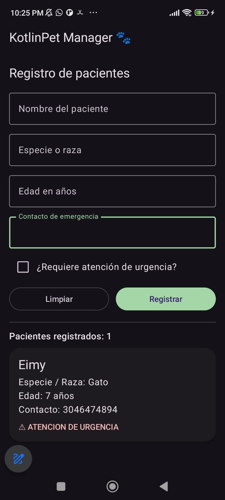

# KotlinPet Manager 🐾

## Información del estudiante
- Nombre: Alan Palacio Serna
- Código: 1089098284

## Descripción
Aplicación móvil desarrollada en Android Studio
utilizando Kotlin, Jetpack Compose y arquitectura MVVM.

Permite registrar pacientes veterinarios,
almacenar sus datos y visualizar sus registros
mediante una lista dinámica.

## Tecnologías
- Kotlin
- Jetpack Compose
- Material 3
- MVVM
- Git y GitHub

## Captura de pantalla

